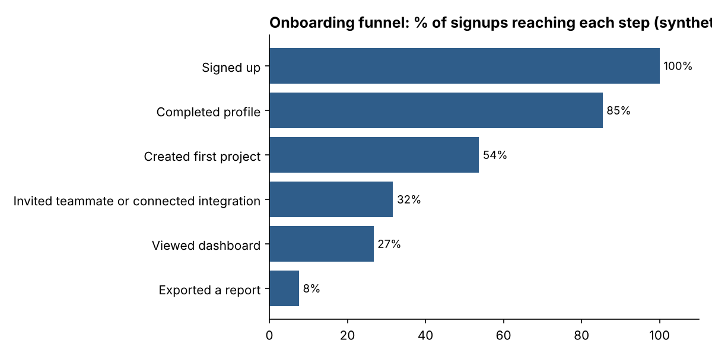
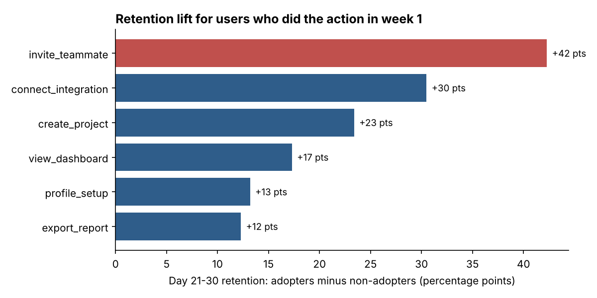

# SaaS Onboarding Funnel and User Retention Study (Case Study)

An analysis of the first 30 days after signup for a SaaS product: where new users drop off, which early actions separate retained users from churned ones, and what in-app nudges could push new users toward those actions. Built with **SQL (SQLite), Python and Excel**.

> **Data note:** all data in this repo is **synthetic**, generated by `src/generate_data.py`. The generator *assumes* that inviting a teammate and connecting an integration in week 1 drive retention, so the analysis recovers those patterns by design. The project shows the analysis workflow, not real-world findings. The same SQL would run on a real event export.

## Business questions

1. Where do new users drop off during onboarding?
2. How does activity hold up over the first 30 days, by signup cohort?
3. Which first-week actions are linked to retention (the "aha moment")?
4. What nudges should guide new users toward those actions?

## Dataset (synthetic)

| Item | Value |
|---|---|
| Users | 6,000 (signups Jan to Jun 2025) |
| Events | 41,259 (signup, profile_setup, create_project, invite_teammate, connect_integration, view_dashboard, export_report, login) |
| Window | First 30 days after signup |
| Retained | Logged in at least once on day 21 to 30 |

Full data is git-ignored. Run the generator to recreate it. A small sample is in `data/sample/`.

## Key results (on the synthetic data)

| Question | Result |
|---|---|
| Funnel | 85.4% complete profile, 53.7% create a project, 31.7% invite a teammate or connect an integration, 7.6% export a report |
| Biggest drop | 37.1% of users who finish their profile never create a project (step 2 to 3) |
| Retention by cohort | Day 21-30 activity is 21.0% to 24.9% across monthly cohorts, so no cohort stands out |
| Strongest week-1 signal | Inviting a teammate: 58.6% retained vs 16.3% without (+42.3 points). Connecting an integration: +30.5 points |
| Combined behaviour | Invited and integrated in week 1: 75.1% retained, vs 13.5% for users who did neither (76% of users) |




**Caution:** these are correlations in simulated data. In a real product, users who invite teammates may already be more committed, so you would confirm with an A/B test before calling it causal.

## Nudge proposals

Three in-app nudges tied to the findings are in [`docs/nudge_proposals.md`](docs/nudge_proposals.md), each with a target group and a success metric. No results are claimed because none have been tested.

## Project structure

```
.
├── data/
│   ├── raw/                  # git-ignored; created by generate_data.py
│   └── sample/               # small committed sample
├── sql/
│   ├── 01_schema.sql
│   ├── 02_funnel.sql                    # CTEs, UNION ALL, FIRST_VALUE / LAG
│   ├── 03_retention_by_cohort.sql       # cohort weekly retention
│   ├── 04_feature_retention_lift.sql    # adopter vs non-adopter, RANK()
│   └── 05_aha_combinations.sql          # segment test, SUM() OVER
├── src/
│   ├── generate_data.py
│   └── run_analysis.py
├── outputs/
│   ├── figures/
│   ├── tables/
│   └── onboarding_analysis_summary.xlsx
├── docs/
│   └── nudge_proposals.md
├── requirements.txt
├── LICENSE
└── README.md
```

## How to run

```bash
git clone https://github.com/<your-username>/saas-onboarding-retention-analysis.git
cd saas-onboarding-retention-analysis
python -m venv .venv && source .venv/bin/activate   # Windows: .venv\Scripts\activate
pip install -r requirements.txt

python src/generate_data.py
python src/run_analysis.py
```

## Limitations

- Synthetic data: the retention drivers are assumptions in the generator, not discoveries.
- "Retained" (a login on day 21 to 30) and "week 1" (day 0 to 6) are definitions I chose and can be changed in the SQL.
- Correlation only. No control group or experiment.

## Tools

Python (pandas, numpy, matplotlib, openpyxl), SQL (SQLite: CTEs, window functions), Excel.

## License

MIT. See [LICENSE](LICENSE).
